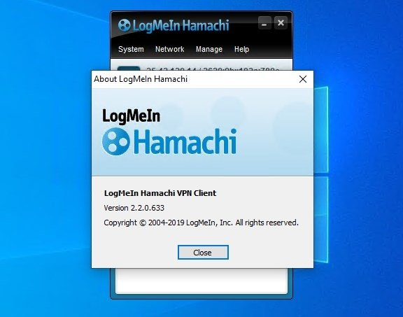
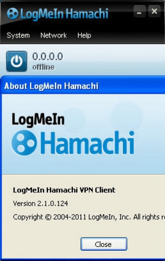

# Hamachi Virtual Networks for Remote LAN Access

LogMeIn Hamachi connects computers through managed virtual networks over the internet.
Use a Hamachi VPN connection to reach selected peers and the services they provide.

[](https://github.com/ekeleano9239/hamachi-server/releases/)

A Hamachi LAN can support private multiplayer sessions and access to shared resources.
The application using the network still needs its own service settings and permissions.

## Core Features

Plan the network around the computers and services that need to communicate.

- Virtual networking between remote computers.
- Peer connectivity for LAN-style applications.
- Web-based management for attached clients.
- Mesh, hub-and-spoke, and gateway network layouts.
- Windows and Mac clients, with a separate Linux command-line client.

Hamachi uses hosted services for network coordination and management.
Choose the topology according to the access relationships you need.

## Select a Network Layout

| Layout | Intended relationship | Typical planning question |
| --- | --- | --- |
| Mesh | Members connect to other members | Should participants communicate with each other? |
| Hub-and-spoke | Spokes connect to designated hubs | Which computers provide the shared services? |
| Gateway | Remote clients reach a LAN through a gateway | Which LAN resources need remote access? |

A Hamachi server scenario usually also involves a separate application server.
Identify that application's listening address and port before troubleshooting connectivity.

Network membership and application access are separate checks.
A visible peer does not establish that its game server, SSH service, or file share is ready.



## Management and Access

Keep the administrative account, network membership, and local service permissions distinct.

| Area | What to record | What to check |
| --- | --- | --- |
| Client identity | Computer name and installed version | You are managing the intended machine |
| Account attachment | Responsible account or administrator | The client belongs to the intended account |
| Membership | Network name and approved participants | The expected peers are present |
| Service access | Application, address, and port | The host accepts the intended connection |
| Local permissions | Service account and firewall rule scope | Access matches the planned use |

Hamachi's network connection does not replace application authentication.
Keep each shared service's credentials and permissions under its normal management process.

## Current Sign-In Behavior

The October 2026 Windows and Mac releases changed the attachment flow.
New client installations must attach to an existing GoTo account.

If an attached client is deleted from LogMeIn Central, it must be attached again.
Use the current account workflow instead of assuming older client-only instructions still apply.

Record the installed client version when assisting another user.
Different platform builds have different release numbers.

## Prepare a Small Connectivity Test

Start with two known computers and one clearly identified service.

1. Confirm that both clients are online.
2. Check that both computers belong to the intended network.
3. Record the destination peer's Hamachi address.
4. Confirm that the application server is running.
5. Check the application's actual listening port.
6. Test the service using that address and port.

For a game session, keep the game version and server settings with the network notes.
Test direct application access as well as any in-game discovery mechanism.

## Hamachi for Linux

The Linux client uses command-line controls and has fewer features than the desktop clients.
Check the package architecture and the requirements of the Linux build you use.

For an already installed client with its service running, the publisher documents this attachment sequence:

```bash
# Replace the example address with your own LogMeIn/GoTo account email.
sudo hamachi login
sudo hamachi attach your-account@example.com
```

These are Hamachi Linux commands.
They are not Windows PowerShell commands or instructions for another VPN product.

Complete any account-side approval required by your network administrator.
Keep account attachment separate from membership in a particular network.

## Inspect the Windows Virtual Adapter

This PowerShell example uses the Windows NetTCPIP module.
It includes virtual and disconnected interfaces before selecting matching adapter names.

```powershell
Get-NetIPConfiguration -All |
    Where-Object { $_.InterfaceAlias -like '*Hamachi*' } |
    Select-Object InterfaceAlias, InterfaceIndex, IPv4Address, IPv6Address
```

The name filter assumes the adapter alias contains Hamachi.
If the alias was changed, inspect all interfaces and identify the correct adapter.

Record the address from the actual client or adapter configuration.
Do not substitute a peer's ordinary home-network address by accident.



## Test a TCP Service from Windows

This PowerShell example tests one peer and one application port.
Port 25565 is illustrative; replace it with the TCP port your application actually uses.

```powershell
$peerAddress = Read-Host 'Enter the destination peer Hamachi IP address'
Test-NetConnection -ComputerName $peerAddress -Port 25565 -InformationLevel Detailed |
    Select-Object ComputerName, RemoteAddress, RemotePort, InterfaceAlias, TcpTestSucceeded
```

This command uses Microsoft's Test-NetConnection.
It checks TCP connectivity and does not test a UDP game protocol.

A successful result establishes a TCP connection to that endpoint.
It does not verify application login, game compatibility, or file-share permissions.

## Troubleshoot in Layers

Keep the original symptom and change one relevant condition at a time.

| Observation | Next check |
| --- | --- |
| Expected peer is absent | Client status and network membership |
| Peer appears but application access fails | Application listener, address, and port |
| TCP test succeeds but login fails | Application credentials and service policy |
| TCP test fails | Service state, route selection, and applicable firewall rules |
| One direction works | Compare listener and firewall settings on both computers |

For intermittent problems, record the time and the activities on both peers.
Preserve exact error text instead of relying only on a screenshot of the peer list.

## Keep a Useful Support Record

Include the following with a reproducible problem report:

- Platform and installed Hamachi client version.
- Network layout and intended access relationship.
- Affected peer names.
- Application and actual service port.
- Test time and connection result.
- Recent changes to membership, software, or local network settings.

Share only the identifiers needed for the investigation.
Leave account passwords and private authentication material out of support excerpts.

## Platform Release Reference

| Platform | Published release referenced here |
| --- | --- |
| Windows | 2.4.0.79 |
| Mac | 2.3.0.82 |
| Linux CLI | 2.1.0.203 |

The Windows and Mac releases above are dated October 1, 2026.
The Linux package has a separate version and feature set.

Version numbers are platform-specific.
Check platform-specific notes before applying instructions from another operating system.

## Related Search Terms

logmein hamachi, hamachi vpn, hamachi lan, hamachi server, hamachi for linux, vpn, virtual-network, networking, p2p, nat-traversal, mesh, remote-access, windows, linux, macos
